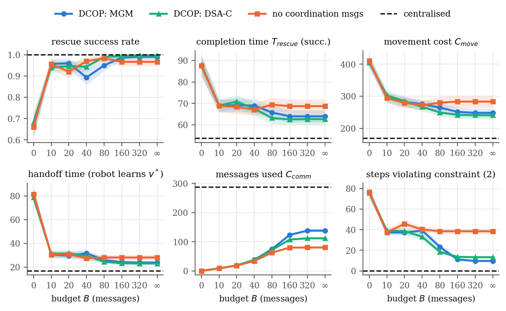
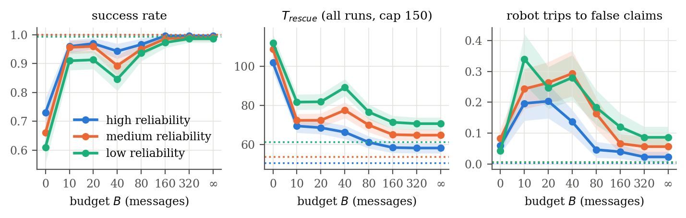
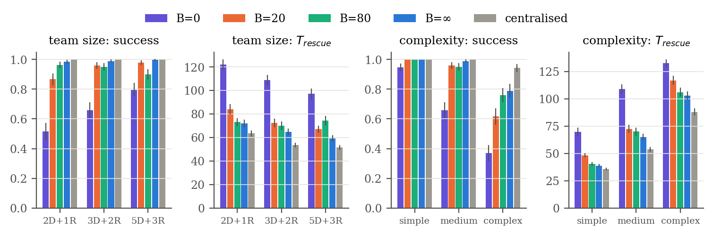
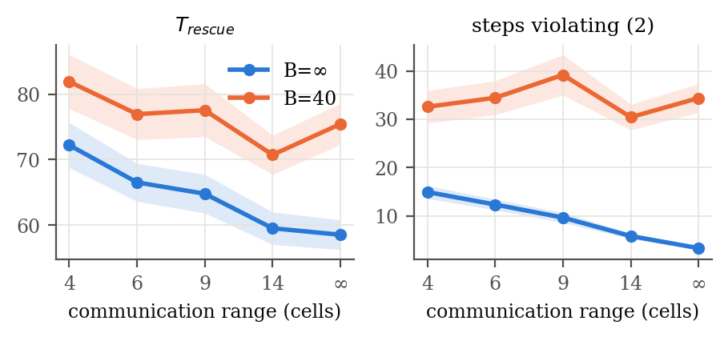
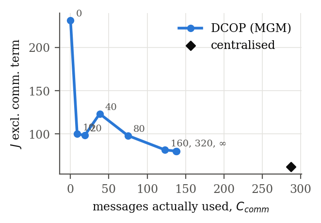
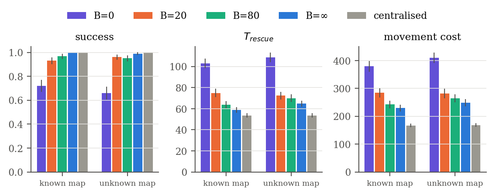
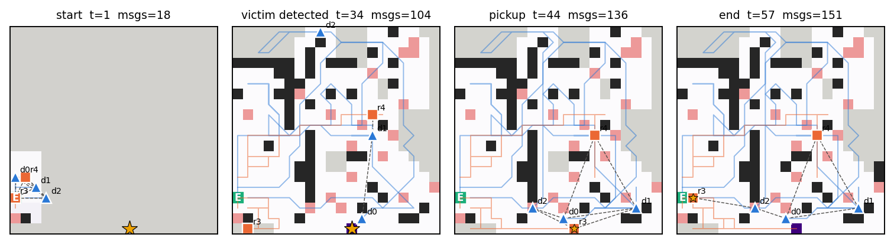
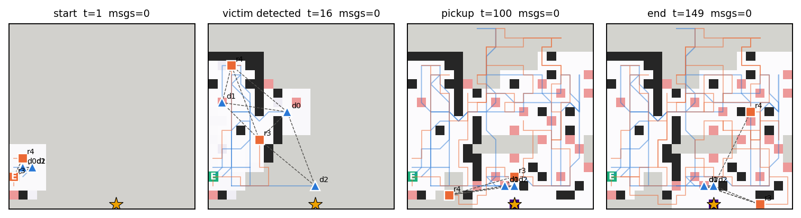
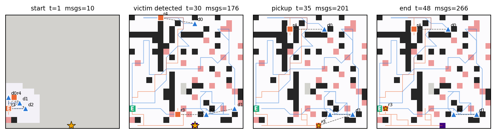
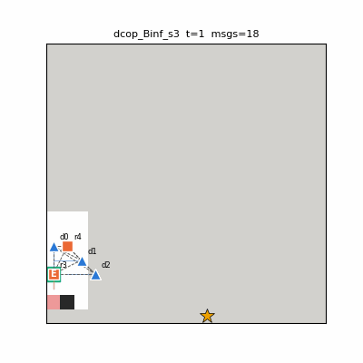

# Decentralised Multi-Agent Search and Rescue under Limited Communication

Final project for **Multi-Agent Systems** (IIT Gandhinagar).
Boinapally Dhanvini (24110079), Bollineni Snehitha Rao (24110081), Jils Shah (24110148), Thaker Shivangi Pareshkumar (24110371).

A person is trapped at an unknown location in a hazardous building. **Search drones** sense well but cannot rescue;
**ground robots** can rescue but sense poorly, so the victim location must travel from drones to robots over a
**limited communication budget** `B`. The floor plan is **unknown** too: agents discover walls and hazards with their
sensors and share them over the same budget.

We compare:

| Approach | Information | Task allocation | Communication |
|---|---|---|---|
| **Centralised baseline** | one pooled Bayesian belief + pooled map | exact assignment, Hungarian method (verified optimal by brute force in the tests) | counted, never limited |
| **Decentralised DCOP: MGM** | each agent's own belief and own map | Maximum Gain Message local search over the range-limited comm graph | range-limited broadcasts, each agent gets `B / |A|` messages |
| **Decentralised DCOP: DSA-C** | own belief and map | Distributed Stochastic Algorithm (variant C), no gain messages | same |
| **No-coordination ablation** | own belief and map | independent best responses | observation messages only |

The full report (8 pages, with Methodology, Results and Contribution sections) is in
[`report/main.pdf`](report/main.pdf); its LaTeX source is [`report/main.tex`](report/main.tex).

## Main results (300 matched seeds per setting, 30,600 episodes)

E1, default setting (20x20 unknown map, 3 drones + 2 robots, medium sensor reliability). T = completion time on
successful runs.

| Method | B | Success | T_rescue | C_comm | C_move | steps violating (2) |
|---|---|---|---|---|---|---|
| Centralised | – | 1.00 | 53.6 | 287.2 | 168 | 0.0 |
| DCOP: MGM | 0 | 0.66 | 87.5 | 0.0 | 410 | 76.6 |
| DCOP: MGM | 10 | 0.96 | 68.8 | 8.6 | 294 | 37.3 |
| DCOP: MGM | 20 | 0.96 | 69.2 | 18.6 | 282 | 37.2 |
| DCOP: MGM | 40 | 0.89 | 68.9 | 38.0 | 275 | 39.2 |
| DCOP: MGM | 80 | 0.95 | 65.8 | 74.7 | 265 | 23.3 |
| DCOP: MGM | ∞ | 0.99 | 63.9 | 138.0 | 248 | 9.6 |
| DCOP: DSA-C | 40 | 0.94 | 67.5 | 37.6 | 267 | 33.0 |
| DCOP: DSA-C | ∞ | 1.00 | 62.6 | 111.7 | 241 | 13.3 |
| No coordination | 40 | 0.97 | 67.0 | 34.0 | 272 | 40.2 |
| No coordination | ∞ | 0.97 | 68.7 | 80.2 | 283 | 38.5 |

Key findings:

1. **Performance collapses only near zero budget.** Two messages per agent (B=10), which carry the drone→robot
   handoff, raise success from 0.66 to 0.96 (90 % of the gap) and cut the robots' wait for the victim location from 81 to
   30 steps.
2. **Decentralised vs centralised.** With unrestricted budget the decentralised team succeeds in 99 % of runs with 48 %
   of the centralised message volume, but is 21 % slower; about half of that gap is the cost of discovering and sharing
   the unknown map (E6: 10 % with a known map).
3. **Communication matters more when sensors are noisy** (success gap B=0 vs ∞: 0.27 / 0.33 / 0.38 for high / medium /
   low reliability). Small and intermediate budgets make robots chase false alarms: claims arrive without the evidence
   that would refute them, giving a non-monotone dip at B=40.
4. **Coordination messages pay off only with enough budget.** At B=40 the uncoordinated variant succeeds most often;
   with a large budget coordination cuts duplicated assignments from 38 to 10–13 steps, and **DSA-C matches MGM with 19 %
   fewer messages**.
5. Smaller teams and larger buildings depend more on communication; a wider radio range closes the gap to the
   centralised baseline when the budget is not binding.

### Figures

Budget sweep (E1):



Sensor reliability (E2):



Team size and building complexity (E3, E4):



Communication range (E5) and the communication/performance trade-off:

<p> </p>

Known vs unknown floor plan (E6):



### Simulator screenshots (seed 3)

Obstacles black, hazards red, exit **E**, drones = blue triangles, robots = orange squares, victim = star, dashed lines =
agents in communication range, purple = belief of drone d0 (or the coordinator's pooled belief), grey = cells d0 (or the
coordinator) has not discovered yet.

Decentralised, unrestricted budget:


Decentralised, no communication (B = 0): drones find the victim early but cannot tell the robots:


Centralised baseline:


Animated episode: [`figures/episode_dcop_Binf_s3.gif`](figures/episode_dcop_Binf_s3.gif)



## Repository layout

```
sar/
  config.py        parameters, sensor-reliability and building-complexity presets
  env.py           building generation (walls, obstacles, hazards, exit, victim)
  mapknow.py       per-agent partial floor plan, optimistic path planning, terrain discovery
  agent.py         heterogeneous agents, noisy sensor model (Eq. 5), Bayesian belief
  allocation.py    task set, cost functions, Hungarian (centralised), best response / conflict checks (DCOP)
  sim.py           simulator, MGM and DSA-C rounds, messaging rule, budget accounting, metrics
experiments/
  run_experiments.py   all experiments (E1–E6) -> results/*.csv
  make_plots.py        figures/*.png and LaTeX tables
  demo.py              episode snapshots and GIF
tests/test_model.py    12 checks: constraints (2)–(4), budget (6), Bayes update, Hungarian optimality (brute force),
                       map discovery/sharing, no agent entering forbidden cells, DSA-C, determinism
results/               raw per-episode CSVs, summary.txt, LaTeX tables
figures/               all plots and screenshots
report/                LaTeX source and compiled PDF of the final report
docs/                  project-review report
```

## Reproducing every number

Requires Python ≥ 3.9.

```bash
pip install -r requirements.txt
python tests/test_model.py                     # sanity checks of the formal model
python experiments/run_experiments.py          # 30,600 episodes, ~13 min on 10 cores
python experiments/make_plots.py               # figures/ + results/summary.txt + tables
python experiments/demo.py --seed 3 --budget -1 --gif   # screenshots (-1 = unrestricted)
python experiments/demo.py --seed 3 --budget 0
python experiments/demo.py --seed 3 --method central
cp figures/*.png report/figures/ && cd report && pdflatex main.tex && pdflatex main.tex   # report
```

Runs are deterministic: the same seed gives the same building and the same sensor noise stream, and every method/budget
is evaluated on the same seeds. A quick run with fewer seeds: `python experiments/run_experiments.py --seeds 20 --only main`.

## Contribution

| Member | Task | Status |
|---|---|---|
| Boinapally Dhanvini | Literature review, formal model (Section 3), choice of MGM/DSA-C over ADOPT, cost functions | Fulfilled |
| Bollineni Snehitha Rao | Environment and agent modelling (building, hazards, movement, observation model, reliability/complexity settings); independent prototype whose unknown-map exploration and DSA-C ideas were integrated into the final code | Fulfilled |
| Jils Shah | Centralised Hungarian baseline, decentralised MGM/DSA-C, communication budget and accounting, integration, tests | Fulfilled |
| Thaker Shivangi Pareshkumar | Experimental design (E1–E6), metrics, plots, tables and analysis | Fulfilled |

All members contributed to integration, testing, debugging and the report.
